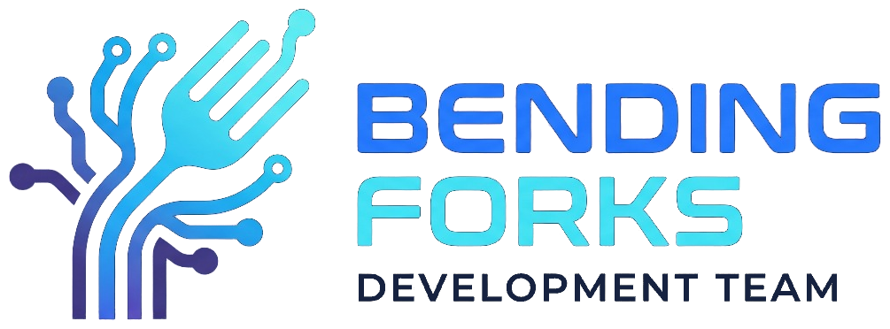

<div align="center">



### Documentazione di progetto

Gruppo 15 · Ingegneria del Software · Università di Padova · 2026/27<br>
Capitolato **C3 · Fossdot**, *smart speaker open source* proposto da Uranion

[](https://bendingforksswe.github.io/)
[](mailto:bending.forks.swe@gmail.com)

</div>

<br>

Questa repository contiene i **sorgenti LaTeX** dei documenti del gruppo.
I PDF aggiornati si leggono sul **[sito](https://bendingforksswe.github.io/)**, che compila automaticamente ogni modifica.

## 📌 Il progetto

- **Capitolato:** [C3 · Fossdot](https://www.math.unipd.it/~tullio/IS-1/2026/Progetto/C3-Fossdot.pdf), proposto da Uranion
- **Committenti:** Prof. Tullio Vardanega, Prof. Riccardo Cardin
- **Corso:** [Ingegneria del Software 2026/27](https://www.math.unipd.it/~tullio/IS-1/2026/)
- **Fase attuale:** Requirements and Technology Baseline (RTB)

## 📁 Struttura

```text
documenti-swe/
├── assets/             logo e firme, usati da tutti i documenti
├── template/           template LaTeX da cui partire
├── candidatura/        documenti della candidatura
│   └── verbali/
│       ├── interni/
│       └── esterni/
│           └── firmati/    PDF firmati dall'azienda
├── rtb/                documenti per la Requirements and Technology Baseline
│   └── verbali/
├── pb/                 documenti per la Product Baseline (in futuro)
└── diario-di-bordo/    presentazioni del diario di bordo (PDF)
```

## 🔁 Flusso di lavoro

**Issue** → **branch** → **pull request** → **verifica** → **merge su `main`**

I commit seguono [Conventional Commits](https://www.conventionalcommits.org/it/v1.0.0/), ad esempio `docs(ndp): aggiunta sezione sulla verifica`.
Tutte le regole sono nelle **[Norme di progetto](rtb/norme_di_progetto.tex)**.

## 👥 Il gruppo

| Componente | Matricola | Email |
|---|:-:|---|
| Marco Beltrame | 2111021 | marco.beltrame.5@studenti.unipd.it |
| Lorenzo Milanese | 2117110 | lorenzo.milanese.1@studenti.unipd.it |
| Filippo Rampazzo | 2101097 | filippo.rampazzo.4@studenti.unipd.it |
| Nicholas Salmaso | 2080038 | nicholas.salmaso@studenti.unipd.it |
| Luca Stangherlin | 2137996 | luca.stangherlin.1@studenti.unipd.it |
| Aldo Toffoli | 2113202 | aldo.toffoli@studenti.unipd.it |
| Matteo Wu | 2075514 | matteo.wu@studenti.unipd.it |
